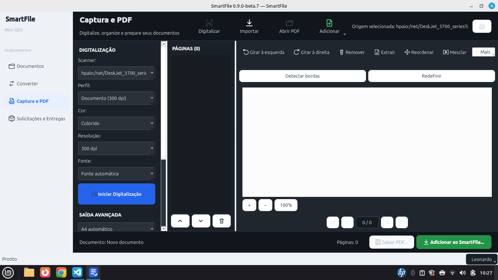
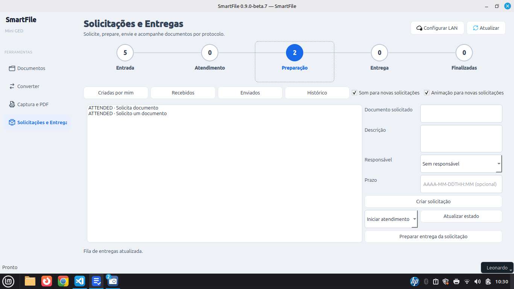
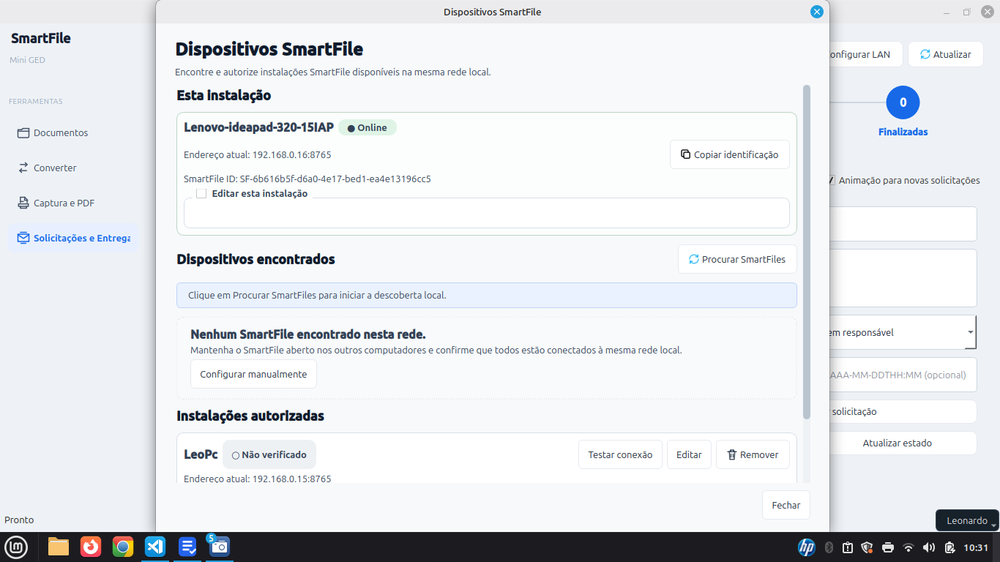

# SmartFile — Documentação Técnica Oficial

Versão de referência: **0.9.0-beta.9**. Schema **23**. Atualização: **13/10/2026**.

## Arquitetura

O projeto separa views, controllers, services, repositories, models, workers e
coordinators. A composição explícita acontece no `AppController`, sem service
locator e reutilizando a instância de banco da sessão.

Na camada empresarial, `DocumentRequestController` controla solicitações,
`CorporateTransportController` controla configuração e teste do transporte,
`CorporateTransportCoordinator` mantém o processamento NAS em background e
`OrganizationSettingsController` concentra os pontos de entrada administrativos.

Um controller traduz eventos de interface em casos de uso. Um coordinator
controla lifecycle recorrente e independente de telas. Um worker executa apenas
uma tarefa demorada fora da thread Qt. Regras, permissões e auditoria permanecem
nos services de domínio.

## Transporte corporativo e reconciliation

`OrganizationTransportService` cria snapshots físicos imutáveis em
`organization_transport_targets`. `organization_transport_settings` aponta para
o target atual, enquanto cada `transport_job` conserva seu próprio
`transport_target_id`. Assim, alteração de endpoint ou rotação de credencial não
redireciona jobs históricos. O único campo mutável do lifecycle do target é o
estado `ACTIVE`/`RETIRED`.

Jobs migrados sem prova de origem recebem `NEEDS_RECONCILIATION`. O repositório
não os entrega à fila normal, `mark_running` aplica a mesma barreira no banco e o
service recusa processamento direto. Caminhos remotos continuam validados pelo
adapter contra a raiz do target correspondente.

## Credential Vault

`CredentialVaultService` depende do contrato `CredentialProvider`. A
implementação `OSCredentialProvider` usa `keyring`: Secret Service no Linux e
Credential Manager no Windows. O SQLite persiste somente refs no formato
`smartfile:transport:<organization_id>:<uuid>`; username e senha existem apenas
no objeto transitório e no cofre.

Rotação cria nova referência e novo target. Uma referência antiga não é apagada
enquanto houver target ativo, job pendente/falho ou upload remoto ainda sem
DELETE concluído. Como SQLite e keyring não compartilham transação, falha de banco
após `store` executa compensação no cofre. Indisponibilidade do keyring não impede
a inicialização da aplicação e nunca produz fallback em texto puro.

## Persistência

Os documentos são armazenados localmente em SQLite através de uma camada de serviço e repositório.
O schema atual é 23. As migrations preservam organizações, documentos,
transportes e entregas existentes. A tabela
`delivery_acknowledgement_receipts` mantém o comprovante separado do documento
original, com UUID, SHA-256, estado de fila e timestamps de envio/recebimento.

## Interface

A interface gráfica é construída com PyQt6.

## Validação documental e artefatos canônicos

A composição no AppController injeta DocumentValidationService,
ValidationLocatorService, CanonicalArtifactService e ValidationRepository nos
fluxos de assinatura e comprovante. DocumentValidationController executa hash e
verificação em worker, rejeitando resultados antigos após mudança de organização.

A migração 22→23 adiciona validation_records e proteções de persistência. O
lifecycle distingue PENDING, ACTIVE, FAILED e REVOKED. Metadados finais são
imutáveis; revogação preserva bytes e histórico. Referências documentais removidas
não provocam exclusão em cascata do registro canônico. Consultas e ações validam
organização e permissões. OWNER/ADMIN administram; EDITOR cria/consulta/exporta;
VIEWER consulta/exporta. Comprovantes também exigem a permissão de confirmação.

O token SFV1 possui 256 bits de aleatoriedade. O QR local utiliza
smartfile:verify:v1:<token>; o código humano é independente. Uma base HTTPS
opcional produz localizador web, conservado no snapshot do registro. URLs locais,
privadas ou com credenciais não são usadas como endereço público. Nenhum serviço
web ou protocolo do sistema operacional é instalado automaticamente.

A finalização insere QR e código antes de assinar, preserva um PDF válido em área
canônica separada, calcula SHA-256 dos bytes finais e ativa o registro. Escrita é
atômica, sem sobrescrita; leitura valida contenção e arquivo regular. Abrir e
exportar conferem tamanho/hash e exportam bytes idênticos. Não há edição in place
nem exclusão do artefato pela API. Falhas não produzem registro ACTIVE fictício.

Estado administrativo, disponibilidade do artefato, integridade da cópia,
assinatura A1/PAdES e confiança da cadeia são resultados independentes. O QR é
localizador; não contém o hash final nem prova autenticidade visual. Copiar o QR
não altera seu vínculo: o original é localizado e a cópia divergente retorna
HASH_MISMATCH. A assinatura visual não equivale a certificado.

BackupService inclui validation_artifacts e delivery_receipts, além do snapshot
SQLite e storage. Credenciais externas permanecem excluídas. A retenção ocupa
espaço adicional e não constitui armazenamento WORM: comprometimento conjunto do
banco e sistema de arquivos por administrador do host está fora da garantia.
Consulte [modelo de ameaça e contratos](QR_VALIDATION_ANTIFRAUD.md) e
[evidências de validação/publicação](qr-validation/AUDIT.md).

## Interface operacional da beta.7

DeliveryWorkspaceView apresenta Entrada, Atendimento, Preparação, Entrega e
Finalizadas, com filtros e contadores de solicitações. Atalhos consultam itens
criados, recebidos, enviados e histórico. Notificações de som/animação têm
preferências próprias e não alteram o transporte. A fila HTTP LAN permanece
separada da Cloud Layer e do NAS; descoberta não implica autorização automática.

Montagem multicloud representa inventário remoto lógico; montagem não importa
arquivos automaticamente. A análise de correspondências distingue candidato e
verificação por evidência. Respostas assíncronas antigas são descartadas ao trocar
contexto. Consulte [Multicloud](MULTICLOUD_WORKSPACE.md).

Captura, geometria, composição e PDF preservam responsabilidades separadas. O
scanner foi homologado para captura e geração correta de PDF. Reconhecimento
universal de formato permanece assistivo/experimental. MediaBox A4 é propriedade
da saída, não evidência de reconhecimento físico. Estados PARTIAL/REVIEW são
mantidos em geometria incerta; não houve nova aquisição nesta atualização de docs.

## Distribuição e verificação

Linux amd64 (.deb), Windows x64 Setup e Portable são produzidos em runners nativos.
A release beta.7 aponta ao commit d047836aae1afba94f42a0f57cd8b842d52b097a,
com 574 testes locais aprovados e checks CI Linux/Windows/Python aprovados.
Hashes SHA-256 acompanham os instaladores. O banco migra de 22 para 23; downgrade
exige dados compatíveis anteriores. Consulte as [notas](RELEASE_NOTES_0.9.0-beta.7.md).

## Referência visual da interface

As nove capturas da beta.7 fornecidas pelo usuário estão em assets/screenshots
e no manual. Elas ilustram a interface; não substituem testes ou homologação.

## Distribuição beta.8

A beta.8 inclui a correção de prévia/recorte e os manuais ilustrados nos bundles
Linux e Windows. Schema 23 permanece inalterado. Instaladores e fontes são
produzidos do mesmo commit e publicados com SHA-256, após validação nativa.
Consulte [notas da beta.8](RELEASE_NOTES_0.9.0-beta.9.md) e
[processo de entrega](RELEASE_PROCESS.md).

## Auditoria beta.9

A composição injeta SessionContext nos serviços usados pela aplicação. Permissões
são verificadas também na organização de destino. Views recebem modelos e catálogos
puros; workers retornam somente ao contexto de origem ainda válido. Repositórios
usam transações e leitura serializada. Saídas públicas são preparadas em temporários
privados e publicadas sem substituir um destino existente, com limpeza limitada aos
arquivos criados pela operação. Recepção usa temporários exclusivos por tentativa.

Schema 23 permanece. Consulte o relatório de auditoria no repositório oficial.
